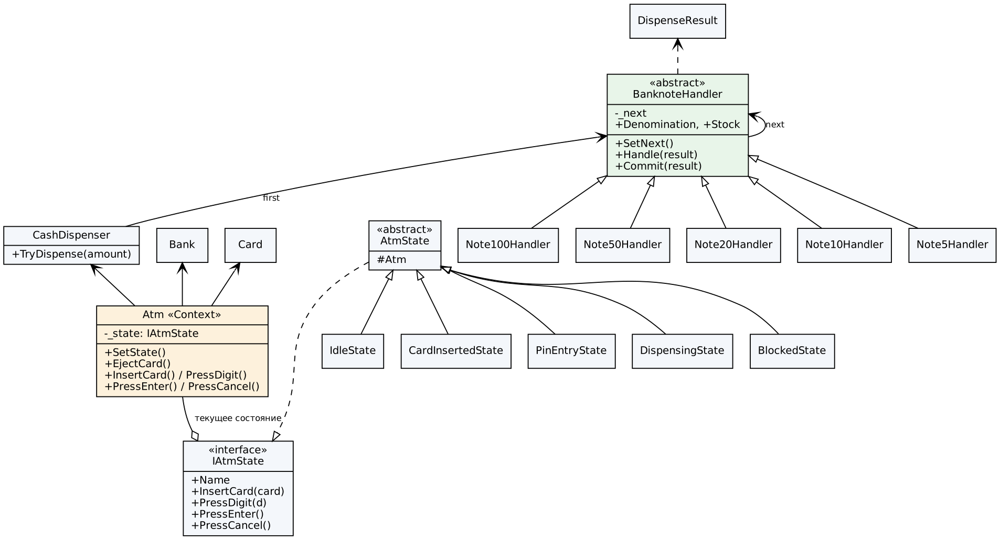
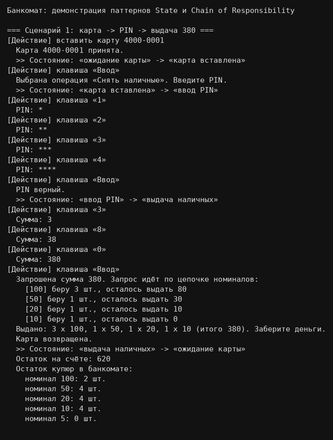
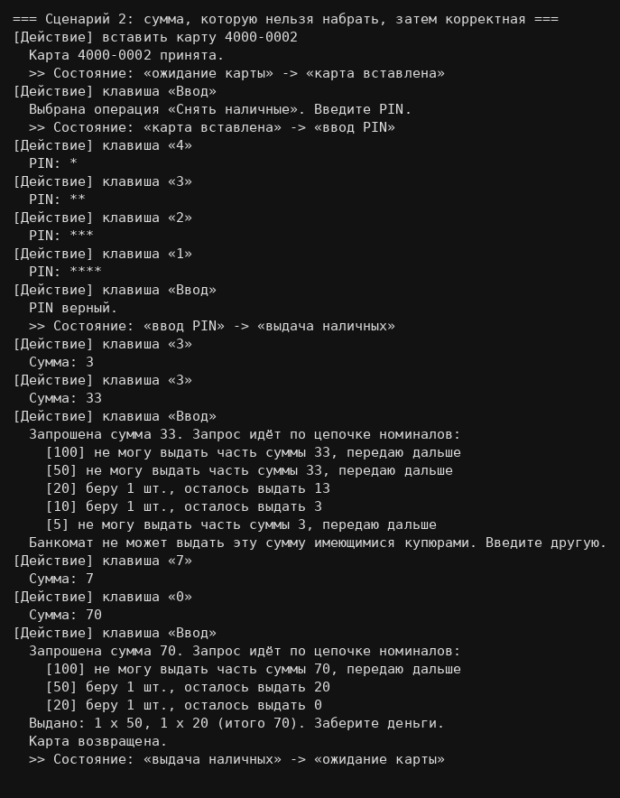
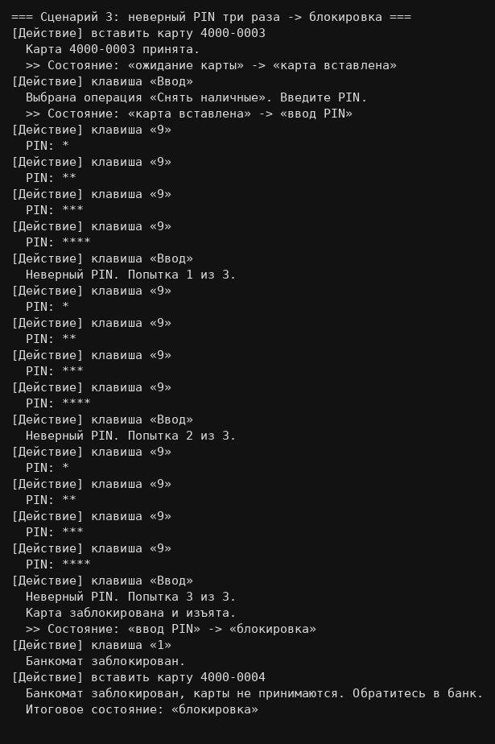

# Банкомат — паттерны State и Chain of Responsibility (вариант 6)

Консольное приложение на C# (.NET 6+): банкомат с состояниями «ожидание карты», «карта вставлена», «ввод PIN», «выдача наличных», «блокировка»; выдача суммы купюрами 100/50/20/10/5, начиная с крупных.

## Паттерны
| Паттерн | Проблема в приложении |
|---|---|
| **State** (`Patterns/State`) | Клавиши и приём карты ведут себя по-разному в зависимости от режима. Каждое состояние — класс, `Atm` лишь делегирует вызовы, без `switch`. |
| **Chain of Responsibility** (`Patterns/Chain`) | Выдача суммы: звенья 100→50→20→10→5 берут свою часть и передают остаток дальше. Новый номинал — новое звено. |

## Обоснование выбора паттернов
- **State вместо enum + switch / флагов:** пять состояний × четыре действия дали бы 20 веток в одном классе; флаги допускают недопустимые комбинации. С паттерном новое состояние — новый класс, контекст `Atm` без условий, недоступные действия обрабатывает базовый `AtmState`.
- **Chain of Responsibility вместо повторяющихся `if`:** каждое звено отвечает за один номинал, порядок задаётся при сборке цепочки, новый номинал — новое звено. Расчёт (`Handle`) отделён от списания (`Commit`), поэтому невозможная сумма не меняет запасы. Простой цикл по номиналам был бы короче, но хуже разделяет ответственность и расширяется.
- **Принципы:** SRP (один класс — одна задача), OCP (расширение без правки), LSP и DIP (контекст зависит от `IAtmState`).
- **Компромиссы:** больше классов; жадный алгоритм выдачи не всегда находит набор, даже если он существует.

## Структура
```
Models/            Card, Bank, CashDispenser
Patterns/State/    IAtmState, AtmState, States (5 состояний), Atm (контекст)
Patterns/Chain/    BanknoteHandler (+ звенья), DispenseResult
Program/           Program (Main), Demo (сценарии)
```

## Диаграмма классов


(исходник PlantUML: `docs/class-diagram.puml`)

## Демо-сценарии
1. Карта → PIN → выдача 380 (3×100, 1×50, 1×20, 1×10).
2. Сумма 33, которую нельзя набрать (нет купюр по 5), затем корректная 70.
3. Три неверных PIN → блокировка; клавиатура и карты игнорируются.

Пример вывода — `docs/sample_output.txt`. Скриншоты:





## Запуск
Visual Studio 2022 (нужна рабочая нагрузка «Разработка классических приложений .NET»):
1. Файл → Открыть → Проект или решение → выбрать `AtmPatterns.csproj`.
2. Нажать **Ctrl+F5** (запуск без отладки — окно консоли не закроется сразу) или зелёную кнопку ▶.

Из терминала (нужен .NET SDK 6+): `dotnet run` в папке с `AtmPatterns.csproj`.
Программа без меню: выполняет три демо-сценария и завершается.
